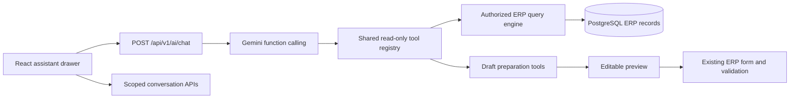

# Quick ERP AI interface and review-only drafts (Version 2, Step 4)

The drawer keeps the existing VYRO Assistant branding and floating launcher. It adapts to a
full-width mobile panel, lists recent scoped conversations, and renders authorized query results
as bounded tables, aggregate KPI cards, and charts when the result shape warrants them. Chart
configuration is owned by the UI; model output cannot choose arbitrary components, HTML, scripts,
or links. Record links are generated only for known ERP routes and checked again against the
frontend permission provider. Backend permissions remain authoritative.

## Chat and history contract

`POST /api/v1/ai/chat` and `DELETE /api/v1/ai/conversations/{id}` remain compatible.
`GET /api/v1/ai/conversations?currentBranchId=...&limit=20&offset=0` returns at most 30 summaries
per page. `GET /api/v1/ai/conversations/{id}?currentBranchId=...&limit=50&beforeId=...` returns at most 100
messages per page, plus `hasOlderMessages`; optional `beforeId` loads earlier messages.
`POST /api/v1/ai/conversations` creates an empty scoped
conversation. Titles are neutral creation dates. History queries require the authenticated tenant,
user, branch, and current permission/module fingerprint. Old messages disappear from the active UI
on user, tenant, role, permission, entitlement, or branch changes; pending requests are cancelled
or ignored. Conversation text lives in PostgreSQL under existing retention, not local storage.

The existing `message`, `conversationId`, `data`, and `source` response fields remain intact.
The frontend recognizes trusted Step 2 `data.operation` results. Query and related results show
approved fields in a paged table. Search groups are flattened only from approved result rows.
One-group aggregations show a KPI; multi-group numeric and comparable period results of at most
24 groups can show a bar chart with a table alternative. Other shapes remain text with
source information. Historic message text currently reloads without its original structured
tool result, because raw business results are intentionally not persisted in message metadata.

## Draft preparation and handoff

Gemini and MCP can call `prepare_sales_quotation`, `prepare_purchase_request`, and
`prepare_crm_followup`. Each is a read-only operation in the same registry. The backend requires
the corresponding create permission, chatbot and module entitlement, a selected permitted branch,
and actual related records found through the secure query engine. These tools return
`handoffOnly=true`, `NEEDS_INPUT`, verified scalar fields, missing fields, and warnings. They do
not calculate unverified totals, reserve numbers, save records, or send messages.

The React preview allows quantity or follow-up details to be edited. For quotations and purchase
requests, **Continue in ERP form** carries only permitted record IDs and quantity to the existing
form, which still applies its own validation, pricing, numbering, and approval rules. CRM follow-up
opens the lead activity form with the reviewed summary and date. It suggests 09:00 as an editable
time and asks the user to review it before saving. The preview is not a
persisted proposal and its button is not a business confirmation endpoint. There is no AI-only
write path, proposal lifecycle table, or duplicate-confirmation risk because the AI never executes
the mutation. A future server-side confirmation workflow requires an authoritative backend domain
service, typed action contract, ownership and expiry, idempotency, revalidation, normal audit, and
integration tests before it can replace this form handoff.

## Development and tests

Run `corepack.cmd pnpm typecheck`, `corepack.cmd pnpm lint`, `corepack.cmd pnpm qa:ai`, and
`corepack.cmd pnpm build` from
`frontend` on Windows. Run the relevant `qa:sales`, `qa:purchasing`, and `qa:crm-leads` scripts
after form changes. From `backend`, set an isolated `QUICKERP_TEST_DB_URL`, then run
`mvnw.cmd clean package`. PostgreSQL integration tests validate scoped history and draft related
record lookup. No live Gemini call is needed for ordinary tests. The UI uses the existing backend
base URL configuration; Gemini credentials remain backend-only.

To add a new presentation type, define a bounded shape derived from validated gateway metadata,
render it with fixed UI components, and test empty/large/malformed data. To add a new AI draft,
verify the normal ERP workflow and exact permission, define narrow typed arguments in the shared
tool registry, validate records through the gateway, keep preparation read-only, provide a review
screen, and test tenant, branch, role, and stale-data behavior. Do not add question-specific
keyword routing or a direct `erp_records` write shortcut.
