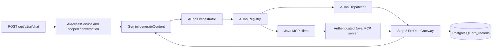

# Quick AI function calling and private MCP (Version 2, Step 3)

## Function calling

`GeminiClient` uses the official Gemini `generateContent` REST protocol. This avoids adding a
second JSON dependency or changing the existing Spring Boot 3.3.5 stack. The configured model
defaults to `gemini-3.5-flash-lite`; it is configurable with `GEMINI_MODEL`. Google's current
[model list](https://ai.google.dev/gemini-api/docs/models) lists that model. The client sends the
central system instruction, scope-checked recent text history, the current user message, and the
read-only declarations generated from `AiToolRegistry`. It preserves Gemini's entire model
`content`, including any thought signatures and function-call IDs, during the active request.
The backend executes requested functions and appends official `functionResponse` parts before
calling Gemini again. No provider session or tool result is stored in conversation history.

The model can answer a general explanation directly, ask a clarification, or call several tools.
Independent calls in one round run in a bounded pool; responses retain request order. Sequential
rounds can discover resources, inspect safe schema, resolve a branch or date period, then query.
Natural-language and mixed-language understanding belongs to Gemini. There are no production
question templates. The final response and the last sanitized tool result use the existing chat
response contract. The conversation ID and scope fingerprint prevent history reuse after a role,
module or branch change. Every chat request resolves current permissions again.

The ten tools are `discover_erp_resources`, `get_resource_schema`, `resolve_erp_branch`,
`resolve_erp_period`, `query_erp_records`, `search_erp_records`, `aggregate_erp_data`,
`compare_erp_data`, `get_related_erp_records`, and `search_erp_knowledge`. The first two expose
only authorized resources and fields. The tool registry takes operation names and descriptions
from `ErpDataGateway.operations()`. One schema adapter supplies both Gemini declarations and MCP
input schemas. The Step 2 gateway remains the only query implementation and checks all arguments
again during execution. Add a new tool by implementing and registering it there, describing its
schema in `AiToolRegistry`, and testing both adapters. No new language routing is needed.

Limits default to five rounds, twelve calls, three parallel calls, 60 seconds total, 100 KB of
tool results, 24,000 history characters, and 1,024 output tokens per provider request. Repeating
an identical call more than twice stops the loop. Exceeding a limit returns an explicit incomplete
answer without fabricating missing figures. Provider 429, timeout, empty responses and MCP
transport failure use stable API error codes. `ai_audit_log` records the outcome, model, duration,
token counts and tool-call count, never prompts, credentials or ERP records. Token counts come from
Gemini `usageMetadata`; they are usage measurements, not a currency cost calculation.

## MCP transport and access

The official `io.modelcontextprotocol.sdk` Java SDK **2.2.0** supplies the Streamable HTTP
servlet transport and Java client. This backend uses `mcp-core` plus `mcp-json-jackson2`, keeping
the existing Jackson 2 and Spring Boot versions. The endpoint is disabled unless
`AI_MCP_ENABLED=true`. When enabled, it is `/api/v1/mcp` on the existing backend port; it accepts
only loopback connections, rejects browser `Origin` headers, and requires an application access
JWT on every request. MCP additionally requires the token's `quick-erp` issuer, `quick-erp-api`
audience, access type and expiry. `AuthService` checks account, tenant, token version and revocation;
`AiAccessService` reloads entitlements, role permissions and allowed branches. Tools receive this
server-derived context from the SDK transport context, never from tool arguments. Platform users
are denied tenant MCP access. MCP `initialize`, `tools/list` and `tools/call` are implemented by the
SDK; a real HTTP integration test exercises all three.

Set `AI_TOOL_TRANSPORT=mcp` with `AI_MCP_ENABLED=true` to route Gemini tool execution through the
SDK client. It opens a fresh MCP session using the current chat user's bearer token, lists tools,
calls the selected tool, and closes the session. The client accepts only a `127.0.0.1` HTTP URL.
It never falls back to direct execution after MCP rejection. The default `direct` mode uses the
same gateway without HTTP overhead. Deployments with a reverse proxy must keep `/api/v1/mcp`
private; the servlet's loopback check is an additional default boundary. The MCP endpoint has no
business-write tools and no arbitrary SQL, URL or Java invocation.

## Local verification

Configure PostgreSQL and the backend-only `GEMINI_API_KEY` in `backend/.env`, then start with
`mvnw.cmd spring-boot:run` on Windows. `GET /api/v1/health` checks the backend. For MCP mode, set
the two flags above and leave `AI_MCP_URL` on loopback. The automated tests use a mocked provider
for function-call behavior and an isolated PostgreSQL schema for the HTTP MCP client/server path;
they do not require a Gemini key. A live Gemini response requires a configured key and a separate
manual smoke test. Set `QUICKERP_LIVE_GEMINI_TEST=true` with `GEMINI_API_KEY` in the test process
and run `mvnw.cmd -Dtest=LiveGeminiFunctionSmokeTest test` to verify a real function call and
function-response continuation. Provider request/response bodies and keys must not be logged.

The isolated MCP fixture grants `customers.view` for one branch and stores a customer named
`Fixture Customer` with a private email. The SDK client discovers `customers`, queries one
permitted row, and confirms that the private email is absent from the result. These are test
records in an isolated schema, not production company data.

## Coverage and next work

The data engine currently validates 17 of 88 catalog resources; the remaining 71 are unavailable
through Gemini and MCP. Revenue, profit, payroll, attendance and several document relationships
remain unsupported where the stored data and business rules are not sufficient. See
[AI_DATA_ENGINE.md](AI_DATA_ENGINE.md). Step 4 can use the same chat response contract and tool
metadata for richer presentation, while business writes require separate controlled workflows.
